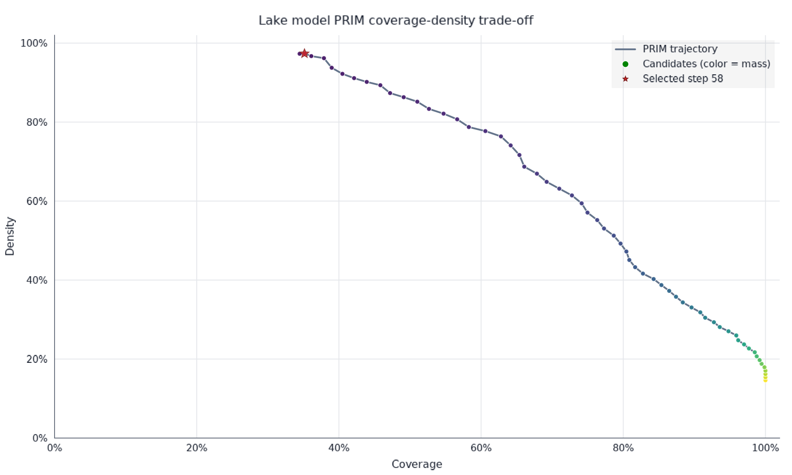
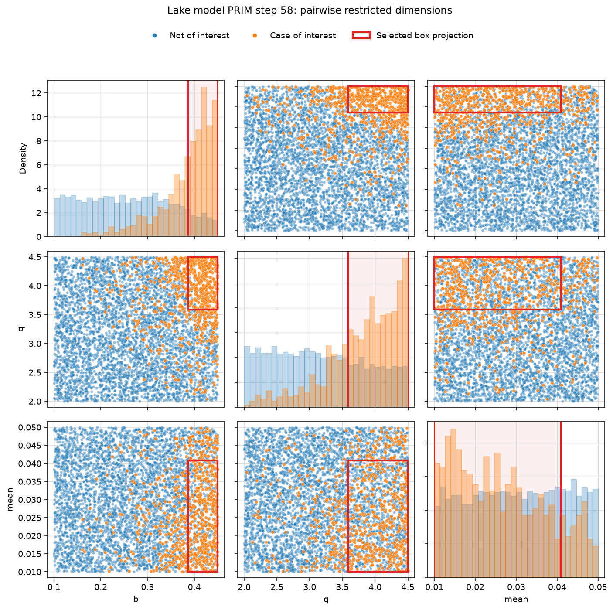

# Tenax

> Hold fast under uncertainty.

**Status:** Roadmap steps 1 and 2 are implemented as an experimental Rust library. The API is not yet stable and no release has been published.

Tenax is a Rust-first toolkit for scenario discovery and robust decision-making under deep uncertainty (DMDU). Scenario discovery identifies combinations of uncertain inputs under which a candidate policy succeeds or fails. Tenax aims to support both analysis of existing experiment data and adaptive evaluation of callable simulation models.

The initial algorithmic focus is the Patient Rule Induction Method (PRIM). Additional scenario-discovery and DMDU methods, such as Classification and Regression Trees (CART), may follow once that foundation has been validated.

## Current functionality

Tenax currently provides a complete path from a Graphcal model or an in-process Rust model to scenario discovery:

- Model schemas, requests, values, and per-row failures in the vocabulary of the [Graphcal](https://github.com/graphcal-lang/graphcal) batch model-evaluation protocol: unit-aware quantity, integer, Boolean, categorical key, and datetime inputs and outputs with declared domains.
- A typed `ModelSchemaBuilder` that declares the session schema of a simple Rust model.
- Deterministic seeded uniform and mixed-domain Latin-hypercube sampling with stable evaluation IDs and explicit model seeds.
- A synchronous, transport-independent, batch-in/result-stream-out `Evaluator` trait that separates per-row failures from evaluator/process failures.
- Per-row success or failure data: failed assertions, out-of-domain inputs, and evaluation errors reported by the model, plus caught unwinding panics and invalid outputs.
- Sequential and Rayon-parallel in-process closure evaluators, with an explicit fixed-row work-chunk policy and completion-order result streaming.
- A `GraphcalEvaluator` (optional `graphcal` feature) that drives a Graphcal model through a persistent `graphcal model serve` session.
- Explicit conversion of a successful evaluation with a Boolean output into a static PRIM dataset; failed rows are rejected rather than silently dropped.

Tenax also implements conventional Patient Rule Induction Method (PRIM) analysis for static binary input/output datasets:

- Continuous, integer, and categorical input features.
- EMA Workbench's `lenient1` default objective, the `lenient2` objective, and the original PRIM objective.
- Quantile-based peeling, data-aware categorical peeling, and pasting.
- Complete candidate trajectories with box limits, member row indices, coverage, density, mass, restricted-dimension counts, and one-sided quasi-p values.
- Repeated box discovery with the members of each final box removed from subsequent searches.

`true` output values identify the cases of interest. A minimal analysis looks like this:

```rust
use tenax::{Dataset, Feature, Objective, Prim, PrimConfig};

fn main() -> Result<(), Box<dyn std::error::Error>> {
    let data = Dataset::new(
        vec![
            Feature::continuous("load", vec![0.1, 0.4, 0.8, 0.9])?,
            Feature::categorical(
                "regime",
                ["stable", "stable", "fragile", "fragile"]
                    .into_iter()
                    .map(str::to_owned)
                    .collect(),
            )?,
        ],
        vec![false, false, true, true],
    )?;
    let config = PrimConfig::new(0.1, 0.1, 0.25, Objective::Lenient1)?;
    let first_box = Prim::new(&data, config).find_box().unwrap();

    for candidate in first_box.trajectory() {
        println!("{:?}", candidate.statistics());
    }
    Ok(())
}
```

### In-process model workflow

A simple Rust model declares its inputs and outputs with `ModelSchemaBuilder` and runs as a closure. It reads typed values from a zero-copy `InputRow` and returns one protocol `Value` per output, or a protocol `RowFailure` (a failed assertion, an out-of-domain input, or another evaluation error): the same per-row vocabulary a Graphcal model uses.

```rust
use tenax::graphcal_model_protocol::{RowFailure, Value};
use tenax::{
    ChunkingPolicy, Evaluator, InputRow, ModelSchemaBuilder, ParallelInProcessEvaluator,
    RowContext, evaluation_to_dataset, sample_uniform,
};

let schema = ModelSchemaBuilder::new()
    .continuous("load", 0.0, 1.0)?
    .categorical("regime", "Regime", ["stable", "fragile"])?
    .boolean_output("failure")?
    .build()?;
let load = schema.input_slot("load").expect("load is an input");
let regime = schema.input_slot("regime").expect("regime is an input");
let failure = schema.output_slot("failure").expect("failure is an output");
let evaluator = ParallelInProcessEvaluator::new(
    schema.clone(),
    move |row: InputRow<'_>, _context: RowContext| -> Result<Vec<Value>, RowFailure> {
        let fragile = row.key(regime)?.as_str() == "fragile";
        Ok(vec![Value::Bool(fragile && row.quantity(load)? >= 0.7)])
    },
    ChunkingPolicy::new(64)?,
);

let request = sample_uniform(&schema, 1_000, 42, 0)?;
let retained_request = request.clone();
let result = evaluator
    .evaluate(vec![request])
    .next()
    .expect("one request produces one result")?;
let dataset = evaluation_to_dataset(&schema, retained_request, result, failure)?;
assert_eq!(dataset.row_count(), 1_000);
# Ok::<(), Box<dyn std::error::Error>>(())
```

Before invoking the model, in-process evaluators reject a request built for another session schema and fail rows whose quantity or integer inputs lie outside their declared domains, as a Graphcal model would. The parallel evaluator partitions request rows into explicit fixed-size work chunks and runs them on Rayon's global thread pool. It yields one `ChunkResult` per request in completion order, which may differ from request order, while restoring rows within each result to their original order. `InProcessEvaluator` remains available as the single-threaded reference implementation.

### Graphcal models

Enable the `graphcal` feature to evaluate a Graphcal model. The re-exported `graphcal_model_client` describes the model, selects the parameters a session varies and the outputs it reads, and starts one persistent `graphcal model serve` process. `GraphcalEvaluator` sends each Tenax request through that session:

```rust
use tenax::graphcal_model_client::{Bool, GraphcalCommand, Model, Quantity};
use tenax::{Evaluator, GraphcalEvaluator, evaluation_to_dataset, sample_latin_hypercube};

let model = Model::describe(GraphcalCommand::new("reliability.gcl"))?;
let load = model.input::<Quantity>("load")?;
let failure = model.output::<Bool>("failure")?;
let session = model.session().vary(&load).output(&failure).spawn()?;

let evaluator = GraphcalEvaluator::new(session);
let schema = evaluator.schema().clone();
let request = sample_latin_hypercube(&schema, 10_000, 42, 0)?;
let retained_request = request.clone();
let result = evaluator
    .evaluate(vec![request])
    .next()
    .expect("one request produces one result")?;
evaluator.shutdown()?;
let failure = schema.output_slot("failure").expect("the session reads failure");
let dataset = evaluation_to_dataset(&schema, retained_request, result, failure)?;
# Ok::<(), Box<dyn std::error::Error>>(())
```

Graphcal models are deterministic, so the request seed is not sent to the server. Quantities are sampled and analyzed in their wire units, and samplers require both domain bounds of every varied quantity, datetime, and integer parameter. Datetimes are sampled as seconds since J2000 in their time scale; complex, indexed, and algebraic parameters cannot be sampled and are rejected. The integration test runs Latin-hypercube sample → `graphcal model serve` → PRIM against a real `graphcal` executable:

```console
GRAPHCAL_BIN=/path/to/graphcal cargo test --features graphcal --test graphcal_workflow -- --ignored
```

### Sampling

`sample_uniform` draws each input independently. `sample_latin_hypercube` places exactly one quantity or datetime sample in each equal-probability stratum and uses independently permuted midpoint inverse-CDF strata for integer, key, and Boolean inputs. The discrete construction remains balanced when rows outnumber available values. Both methods derive input streams, request IDs, and model seeds deterministically from the run seed and request sequence.

### Lake model workflow example

[`examples/lake_model/`](examples/lake_model/) applies the complete current workflow to the Direct Policy Search lake problem from EMA Workbench's open-exploration tutorial. It samples 5,000 joint uncertainty-policy inputs, evaluates the stochastic model with deterministic row seeds, classifies `max_P < 0.8`, runs PRIM, and exports the complete trajectory. A pinned Python script uses [XY](https://reflex.dev/docs/xy/) to produce interactive HTML and static PNG trade-off, experiment, and box-limit plots. XY's Matplotlib-compatible pyplot layer composes the EMA-style pairwise scatter-and-box plot, also exported as interactive HTML and static PNG, without requiring Matplotlib.

```console
cargo run --release --example lake_model
./examples/lake_model/plot.py
```

The pinned run produces a 59-step coverage-density trajectory. Its final candidate has 35.2% coverage, 97.3% density, and 5.28% mass, restricting `b`, `q`, and `mean`.



The selected box can also be projected onto every pair of restricted dimensions, with cases of interest in orange and box limits in red:



The example documents the current differences from EMA Workbench, including its deliberate use of uniform rather than the now-available Latin-hypercube sampler, joint rather than factorial experiments, a binary classification output, and fixed-size Rayon work chunking.

Run the complete test suite with `cargo test --all-targets --all-features`, and run documentation examples separately with `cargo test --doc --all-features`.

### Continuous integration

[GitHub Actions](.github/workflows/ci.yaml) runs on pull requests and pushes to `main`. CI checks formatting, Clippy, and rustdoc with warnings denied; tests the core and all-features configurations on Linux, macOS, and Windows (including doctests); verifies each feature on the minimum Rust version declared in `Cargo.toml`; audits dependencies with RustSec; and validates workflows with actionlint and zizmor. Builds use the pinned `rust-toolchain.toml` and committed lockfile. The `CI gate` job requires every check to succeed and can be selected as a required status check in repository settings.

### Independent reference suite

The integration fixture in [`tests/fixtures/ema_workbench_3_0_0.json`](tests/fixtures/ema_workbench_3_0_0.json) is generated independently by EMA Workbench 3.0.0. The Rust integration test compares every trajectory entry—including limits, selected rows, diagnostics, and quasi-p values—across all three objectives, mixed feature types, and a trajectory with explicit pasting.

Regenerate the reference fixture with:

```console
./scripts/generate_ema_reference.py
```

The executable script uses `uv` inline metadata to pin EMA Workbench and does not import or invoke Tenax.

## Vision

Tenax is planned as a toolbox composed of:

- A reusable Rust library containing the analysis algorithms and transport-independent evaluator interfaces.
- A Rust CLI that analyzes existing datasets or drives callable models through local or remote evaluators.
- A Python library, backed by the Rust core through PyO3, for use in scripts and notebooks.

A model evaluator maps a batch of input configurations to model outputs. It may run in process or behind a remote protocol; analysis algorithms should not depend on the transport used.

## Design goals

- **Correctness and reproducibility:** Validate conventional implementations against synthetic fixtures, behavioral invariants, published examples, and reference implementations such as EMA Workbench.
- **Efficient use of expensive models:** Use adaptive sampling to concentrate evaluations in informative regions instead of relying only on a fixed, precomputed ensemble.
- **Incremental execution:** Reuse previous model evaluations as new observations become available.
- **Batch-parallel execution:** Select and evaluate multiple model configurations concurrently.
- **Anytime results:** After each evaluation batch, return a valid intermediate result together with progress or uncertainty diagnostics, allowing execution to stop at a budget or deadline.
- **Measured performance:** Use Rust for a low-overhead, memory-efficient core, and substantiate performance claims with benchmarks.

## Roadmap

1. **Complete:** Implement conventional PRIM for static input/output datasets and establish a correctness test suite against EMA Workbench.
2. **Complete:** Implement a transport-independent evaluator abstraction, reproducible uniform and Latin-hypercube sampling, sequential and Rayon-parallel in-process workflows, and Graphcal model evaluation through the Graphcal batch model-evaluation protocol.
3. Implement adaptive scenario discovery with explicit acquisition and stopping rules. Benchmark it against fixed Latin-hypercube sampling on representative problems.
4. Add remote and asynchronous evaluation, including cancellation, and a CLI client.
5. Publish a Python package that wraps the Rust core through PyO3 and provides a notebook-friendly API.
6. Evaluate additional analysis methods, such as CART, robustness metrics, and sensitivity analysis, based on demonstrated user needs.

## What is not in scope

- Implementing users' domain-specific simulation models. Tenax treats those models as evaluators.
- Building a dedicated high-density visualization engine. Tenax should expose results in formats that work with visualization libraries such as [Datashader](https://datashader.org/) and [XY](https://reflex.dev/docs/xy/).

## License

Licensed under either of:

- MIT License ([LICENSE-MIT](LICENSE-MIT))
- Apache License, Version 2.0 ([LICENSE-APACHE](LICENSE-APACHE))

at your option.
